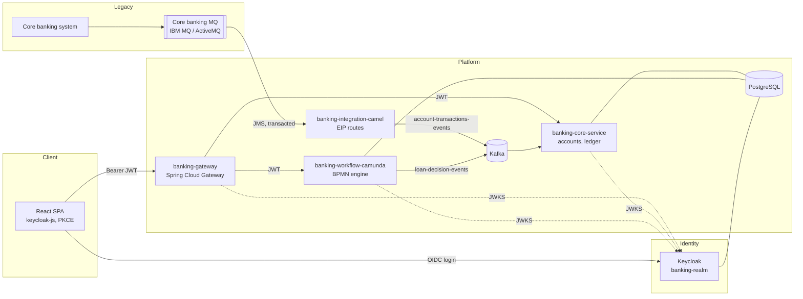
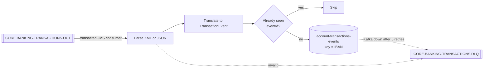
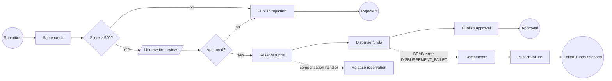
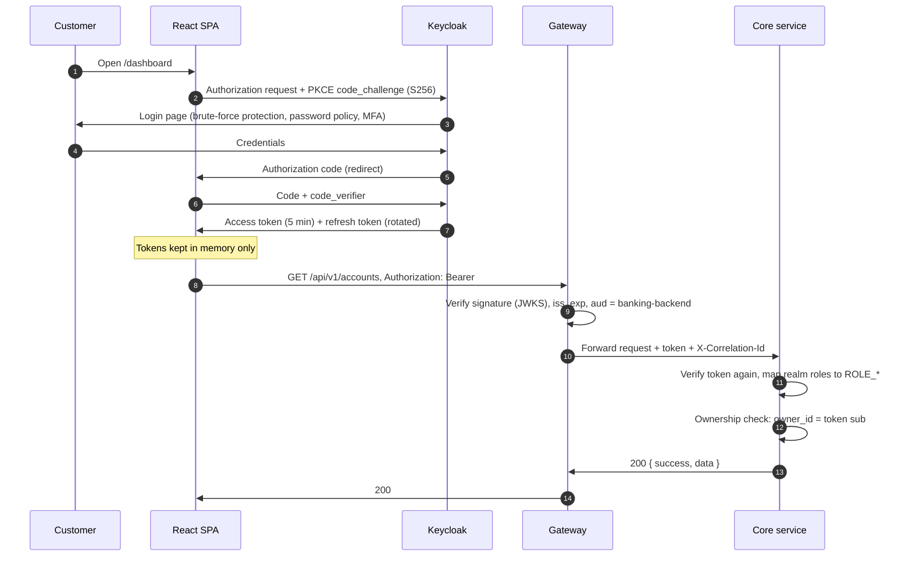

# Architecture blueprint

This document explains how the platform's moving parts fit together and why. It covers the four pillars of the
design: integration and routing, workflow orchestration, identity and access, and transactional integrity.

## System context

| Module | Responsibility | Port |
|---|---|---|
| `banking-gateway` | Single entry point. JWT validation, routing, CORS, correlation id, security headers | 8080 |
| `banking-core-service` | Accounts and transactions. REST API, JPA/Flyway, Kafka ledger projection | 8081 |
| `banking-integration-camel` | Legacy MQ ⇄ Kafka bridge: message translation, idempotency, dead-letter handling | 8082 |
| `banking-workflow-camunda` | Long-running processes (loan approval, KYC onboarding), user tasks, compensation | 8083 |
| `banking-common` | Shared contracts: API envelope, error codes, events, audit logging, Keycloak role mapping | library |

---

## 1. Integration and routing (Apache Camel, MQ, Kafka)

The core banking system remains the system of record. It speaks JMS over a message queue. The rest of the platform
speaks events on Kafka. Apache Camel sits in between and owns every protocol and format translation, so neither side
has to know about the other.

### Inbound: core → platform (implemented in `JmsToKafkaRoute`)

Enterprise Integration Patterns used:

| Pattern | Where | Why |
|---|---|---|
| Transactional client | `jms:queue:...?transacted=true` | The MQ message is removed only after Kafka has acknowledged it |
| Content-based router | `CoreMessageParser` | One route accepts both XML and JSON from different core modules |
| Message translator | `TransactionEventMapper` | Legacy codes (`DrCr=C`) become a typed, versioned canonical event |
| Idempotent consumer | `idempotentConsumer(eventId)` | MQ redeliveries never produce duplicate events. The event id is a name-based UUID of the core reference, so it is the same on every redelivery |
| Dead letter channel | `errorHandler(deadLetterChannel(...))` | Poison messages are parked with the reason attached. They never block the queue |
| Correlation identifier | `X-Correlation-Id` header | One id follows a transaction from MQ to Kafka to the database to the logs |

### Outbound: platform → core (next step)

Commands to the core (reserve funds, disburse a loan, post a transfer) use **request-reply over MQ**: a Camel route
sends the command with `JMSReplyTo` and `JMSCorrelationID`, waits for the reply with a timeout, and returns the
result to the caller. The caller is usually a Camunda service task. A timeout becomes a technical incident in
Camunda, not a silent failure.

### Kafka topic design

| Topic | Key | Partitions (local) | Producer | Consumers |
|---|---|---|---|---|
| `account-transactions-events` | IBAN | 6 | integration-camel | core-service ledger, notifications, fraud (future) |
| `account-transactions-events.DLT` | (none) | 1 | core-service error handler | operations |
| `loan-decision-events` | application id | 3 | workflow-camunda | notifications, CRM (future) |

* **Ordering** is guaranteed per key. All events of one account land in the same partition and are processed in order.
* **Durability**: producers use `acks=all` and idempotence. In production, use a replication factor of 3 and `min.insync.replicas=2`.
* **Schema evolution**: every event carries `schemaVersion`. Add fields only, never rename or remove them. Move to a schema registry (Avro or Protobuf) before a second team consumes the topics.
* **IBM MQ**: swap `spring-boot-starter-activemq` for IBM's `mq-jms-spring-boot-starter`. The routes do not change because they use the generic `jms:` component.

---

## 2. Workflow orchestration (Camunda)

Banking processes run for minutes to weeks, wait for people (underwriters, compliance) and call unreliable external
systems. They need durable state, timeouts, retries, an audit trail and a way to undo work. A BPMN engine provides
all of that, and the model stays readable by business analysts.

### Loan approval (`bpmn/loan-approval.bpmn`)

Design rules applied in the model:

* **Asynchronous continuations are transaction boundaries.** Every task that calls another system is `asyncBefore`.
  The engine commits its state before the call, so a crash or timeout retries only that step (3 retries by default,
  then an incident in Cockpit).
* **Business errors and technical errors are different things.** A rejected disbursement is a *BPMN error*: the model
  handles it on purpose. A network failure is an *exception*: it is retried, then raised as an incident for operations.
* **Compensation implements the saga.** "Reserve funds" declares a compensation handler ("Release reservation").
  When disbursement fails, the throw event runs the handlers of completed steps in reverse order. Handlers must be
  idempotent because the engine may run them again after a crash.
* **People are modelled as user tasks** with candidate groups (`underwriters`), so work queues, SLAs and the audit trail
  come from the engine.
* **Money in process variables is stored as strings.** Camunda would otherwise Java-serialize `BigDecimal`, which is
  disabled by default for security reasons.

### KYC onboarding (next process)

Customer submits documents, then automated identity verification (external provider, a *message catch event* waits
for its webhook), then sanctions/PEP screening. Any hit opens a compliance user task. A *timer boundary event*
escalates if the provider has not answered within its SLA. On approval, the account is opened in the core through
request-reply over MQ.

### Camunda 7 or Camunda 8

This repository embeds **Camunda 7** because it runs inside a Spring Boot app with nothing extra to operate, which
suits local development and the first sprints. Before you commit to it, note that the Camunda 7 Community Edition
has reached end of life (7.24 is its last release, October 2025). The options are:

| Option | What it means |
|---|---|
| Camunda 8 (Zeebe) | Separate, horizontally scalable engine. Delegates become job workers. Production use requires a Camunda licence |
| Camunda 7 Enterprise | Paid extended support for the 7.x line |
| Operaton | Community fork of Camunda 7, API compatible |

The BPMN models carry over to all three. The Java delegates need to be rewritten as job workers only for Camunda 8.
Make this decision as an architecture decision record before the end of the first program increment.

### Runtime support status (checked November 2026)

The stack in this repository is the **last Spring Boot 3 generation**. Several of its parts no longer get free security fixes:

| Component | Version used | Open-source support |
|---|---|---|
| Spring Boot | 3.5.16 (final 3.x OSS patch) | Ended 30 June 2026 |
| Spring Cloud | 2025.0.3 (final release of the train) | Ended 30 June 2026 |
| Camunda 7 CE | 7.24.0 (final CE release) | Ended October 2025 |
| Apache Camel | 4.18.5 LTS (last line on Spring Boot 3) | Until February 2027 |

These pieces depend on each other: Camunda 7 CE only supports Spring Boot 3.5, and Camel 4.18 is the last line on
Spring Boot 3. A regulated bank should not go live on unpatched components, so pick one path before production:

1. **Move to Spring Boot 4.x** (Spring Cloud 2025.1+, Camel 4.22 LTS+), together with Camunda 8 or Operaton for the workflow engine.
2. **Stay on 3.5 with commercial extended support** (Broadcom Tanzu Spring, or a third-party vendor) plus Camunda 7 Enterprise.

Option 1 costs migration effort now. Option 2 costs licences and delays the migration. Both are viable; choosing
neither is not.

---

## 3. Identity and access (Keycloak)

### Login and API call

Key decisions:

* **The SPA is a public client with PKCE.** No secret ships to the browser. Implicit flow and password grant are disabled.
* **Tokens are kept in memory**, never in `localStorage`, which limits what an XSS bug can steal.
* **Audience restriction.** Tokens for the platform carry `aud=banking-backend`. Every service rejects tokens minted for other clients.
* **Zero trust inside the network.** The gateway is not a trust boundary. Every service validates the JWT itself, so a request that bypasses the gateway gets nothing.
* **Authorization in two layers.** Roles (`CUSTOMER`, `TELLER`, `UNDERWRITER`, `ADMIN`) control which endpoints a caller can use. Data ownership (`owner_id = sub`) controls which rows. A foreign account returns 404, not 403, so ids cannot be probed.
* **Service-to-service calls.** Use the client credentials grant for technical calls, and OAuth 2.0 Token Exchange (RFC 8693) when a downstream call must keep the customer's identity. Add mTLS between services through a service mesh (Istio or Linkerd) or Spring Boot SSL bundles.
* **Strong customer authentication (PSD2).** Transfers and beneficiary changes will request a step-up (`acr` level of assurance) from Keycloak before the API accepts them.
* **Camunda webapps** use their own login locally. Connect them to Keycloak (Camunda Keycloak identity plugin, or SSO for Camunda 8) before any shared environment.

---

## 4. Distributed transactional integrity

Kafka, the MQ and PostgreSQL cannot share one ACID transaction, and XA/two-phase commit across them is fragile and
slow. The platform guarantees consistency with these patterns instead:

| Concern | Pattern | Status |
|---|---|---|
| Losing a core message between MQ and Kafka | Transacted JMS consumer: the MQ message is acknowledged only after Kafka confirms the write | Implemented |
| Duplicates from redelivery | Deterministic event ids, plus idempotent consumers: unique `transaction_ref` constraint and existence check | Implemented |
| Concurrent balance updates | Optimistic locking (`@Version`) and retry with backoff in the Kafka error handler | Implemented |
| Poison messages | DLQ on MQ, `.DLT` topic on Kafka, with no retries for validation errors | Implemented |
| DB write and event publish must both happen | **Transactional outbox**: write the event to an `outbox` table in the same DB transaction, then publish it with Debezium CDC or a polling relay | Next step for core-service and workflow |
| Multi-step business operation across systems | **Saga orchestrated by Camunda**, with BPMN compensation | Implemented (loan approval) |
| Read-process-write inside Kafka | Kafka transactions (exactly-once semantics) with `isolation.level=read_committed` | Consumers already read committed |
| Drift between the platform and the core | Daily reconciliation of balances and transaction counts against the core's end-of-day files, with alerting | Planned |

Rules of thumb for every new feature:

1. Every consumer is idempotent. Assume each message arrives at least twice.
2. Every event has a stable key, an id, a schema version and a correlation id.
3. A process step that changes something elsewhere has a compensating step, or a documented reason it does not need one.
4. Nothing is deleted on failure. It goes to a DLQ/DLT with the reason, and operations can replay it.

---

## Security and compliance baseline

| Area | Baseline in this repository | Before production |
|---|---|---|
| Transport | HSTS, CSP, `no-referrer` at the gateway | TLS 1.2+ everywhere, mTLS between services |
| Data at rest | Separate DB and role per bounded context | Storage encryption, field-level encryption for PII (Vault Transit or pgcrypto), key rotation |
| Secrets | Dev defaults in `.env.example` only | HashiCorp Vault or a cloud KMS, no secrets in images or Git |
| Audit (PCI-DSS req. 10) | Dedicated `AUDIT` logger, actor, action, resource, outcome, correlation id | Ship to append-only (WORM) storage, retain at least 1 year |
| Card data (PCI-DSS) | No PAN stored anywhere | Tokenize through the card processor to keep the platform out of PCI scope |
| PII in logs | `PiiMasker` for IBAN and email, masked IBAN in APIs | Log scanning in CI |
| Accessibility | WCAG 2.1 AA patterns: landmarks, skip link, focus styles, labels, status not by colour alone | Automated axe checks in CI, manual screen-reader test |
